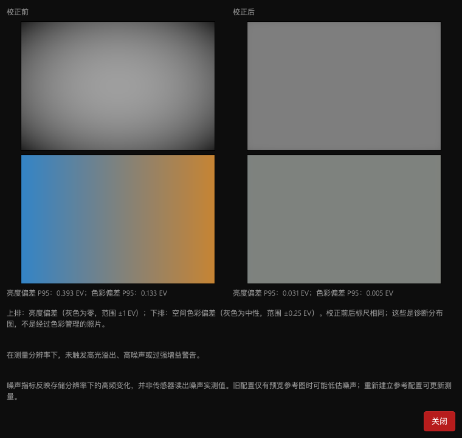
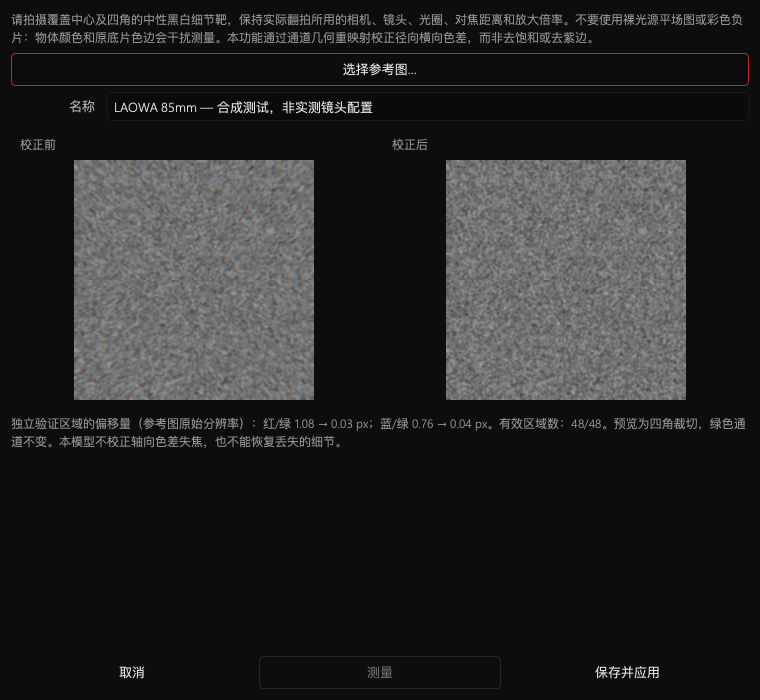

# NegPy M 系列处理器优化版
# NegPy Apple Silicon Optimized Edition

**非官方定制版 / Unofficial custom build**

本仓库提供基于 [marcinz606/NegPy](https://github.com/marcinz606/NegPy) 的 **0.65.0 / r8** 定制快照，不是官方 0.66.0，也不代表已包含官方主分支所有新改动。原作者、贡献者及许可证保持不变。

This repository publishes the locally validated **0.65.0 / r8** custom snapshot of [marcinz606/NegPy](https://github.com/marcinz606/NegPy). It is not an official 0.66.0 release and does not claim every newer upstream-main change. Upstream authorship, credits and licenses remain intact.

[下载 / Releases](https://github.com/easonzhangbin/NegPy-Apple-Silicon-Optimized-Edition/releases) · [使用指南 / User guide](docs/USER_GUIDE.md) · [验证报告 / Validation report](docs/reports/r8-validation.md)

## 定制功能 / Custom features

| 项目 / Area | 中文 | English |
|---|---|---|
| Apple Silicon | 动态 OpenMP LibRaw、多核预算、三色并行解码、统一内存缓存与低内存保护。 | Shared OpenMP LibRaw, bounded multicore decoding, parallel trichrome decoding and memory-budgeted caches. |
| 导出 / Export | TIFF 编码到临时文件后原子替换，减少中间内存占用。 | TIFF encoding to a temporary file followed by atomic replacement, limiting intermediate memory use. |
| 平场 / Flat field | 独立亮度与空间色彩强度、前后诊断图、参考图质量提示。 | Separate brightness/color strengths, before/after maps and reference-quality warnings. |
| 色差 / Lens CA | 从中性参考靶测量径向横向色差，经独立区域验证后保存。 | Reference-based radial lateral-CA measurement, held-out validation and reusable profiles. |
| 中文 / Chinese | 保留上游多语言机制，维护摄影、暗房术语修订表。 | Retain upstream localization with a reviewed Chinese photography/darkroom terminology overlay. |

Metal/WebGPU 原本就是 NegPy 的功能，不是本分支从零新增。平场与实测色差在 CPU 端预处理线性源图，后续渲染使用原有 GPU 后端；不宣称所有操作走 GPU，或所有 M 系列设备都有相同加速。

Metal/WebGPU is an existing upstream feature. Flat-field and measured CA run on the CPU linear-source path before the existing GPU renderer. Not every operation runs on the GPU, and no universal speedup is claimed for every M-series device or workload.

## 使用与限制 / Usage and limitations

- **平场：整卷 → 光学。** 总强度、亮度、色彩均为 0–200%，默认 100%，分量与总强度相乘。“分析平场…”用同一标尺比较前后分布，提示高光溢出、噪声/纹理及过强增益。分离基于共同与通道相对的 RGB 对数增益，不保证严格保持 CIE 亮度；噪声指标不是传感器读出噪声实测。
- **Flat field: Roll → Optics.** Total, brightness and color strengths range from 0–200%, default 100%; component strengths multiply the total. Analyze Flat Field compares maps on fixed scales and warns about clipping, noise/texture and excessive gain. The split uses common and relative RGB log-gain, not strict CIE luminance preservation or a sensor read-noise measurement.
- **色差：整卷 → 光学 → 校准镜头色差…（实验性）。** 使用覆盖中心与四角的中性黑白细节靶，保持实际相机、镜头、光圈、对焦距离、倍率与裁切模式。测量后检查四角，验证通过才保存。不要用裸光源平场图或彩色负片校准。
- **CA: Roll → Optics → Calibrate Lens CA… (experimental).** Use a neutral black-and-white textured reference covering the center and corners, matching the actual camera, lens, aperture, focus distance, magnification and crop mode. Measure, inspect corners and save only a validated fit. Do not use a flat light field or color negative.
- 这是红、蓝通道相对绿色的几何重映射，不是去紫边。当前仅支持普通单帧 RGB，不支持拼接、HDR、三色合成及 RGB+IR；不修复轴向色差失焦、偏心/切向误差或已丢失细节。没有预置 LAOWA 镜头实测配置。
- This remaps red/blue geometry relative to green, not desaturation or defringing. Ordinary single-frame RGB only; no stitch, HDR, trichrome or RGB+IR support. It does not fix axial blur, decentering/tangential errors or lost detail. No measured LAOWA lens profile is supplied.





## 安装、升级与备份 / Installation, updates and backup

Apple Silicon Mac 专用构建。安装前退出全部 NegPy，备份用户目录（通常为 `~/Documents/NegPy`），保留旧 App。本地包使用临时签名，未经 Apple 公证；不要同时运行共用数据库的多个版本。

For Apple Silicon Macs. Quit every NegPy instance, back up the user directory (normally `~/Documents/NegPy`) and retain the old app. Local packages are ad-hoc signed, not Apple-notarized. Do not run multiple versions against the same database.

平场配置在 `flatfield`，镜头配置在 `lens_ca`，镜头系数也保存在编辑参数中。升级保留数据不代表官方版会执行定制功能：仍需移植代码并重新验证；旧版重新保存编辑可能丢失未知字段。相机依赖随包提供，不代表 A1/M11 已通过实机联机验证。

Profiles live in `flatfield` and `lens_ca`; lens coefficients also persist in edits. Keeping data does not make official builds execute custom features: code still needs porting and validation. Older builds can discard unknown fields when re-saving. Bundled camera dependencies do not imply real-device A1/M11 tethering validation.

## 源码构建 / Build from source

需要 Apple Silicon Mac、Python 3.13、`uv`。始终使用独立开发用户目录。此入口只打包，不自动安装。

Requires an Apple Silicon Mac, Python 3.13 and `uv`. Always use an isolated development user directory. This entry point builds without installing.

```sh
uv sync --locked --group camera
NEGPY_USER_DIR=/private/tmp/negpy-development uv run --no-sync python -m scripts.build_apple_silicon --output /absolute/path/to/output
```

`third_party` 包含匹配运行库、源代码归档与许可证。`apple-silicon-build` 是历史资料，部分脚本会替换 App 或使用旧链接方式，不应直接执行；当前入口为 `scripts/build_apple_silicon.py`。

`third_party` contains the matching runtime, source archives and licenses. `apple-silicon-build` is historical material; some scripts replace an app or use old linking methods. Do not execute them directly; use `scripts/build_apple_silicon.py`.

## 致谢与贡献 / Credits and contributions

感谢 NegPy 原作者与贡献者。保留 [GPL-3.0](LICENSE) 及第三方许可证。代码整理和部分实现使用 AI 编程辅助并经过本地测试，不代表上游认可。向上游贡献时应分别提交平场、性能、色差和术语改动，而非整包快照。

Thanks to the upstream author and contributors. [GPL-3.0](LICENSE) and third-party licenses are retained. Code preparation and parts of the implementation used AI coding assistance and local testing; this does not imply upstream endorsement. Propose flat-field, performance, CA and terminology changes separately rather than submitting the entire snapshot upstream.

---

## 原项目介绍（保留原文）/ Original upstream introduction

<div align="center">
  <h1>NegPy</h1>

  [](https://github.com/marcinz606/NegPy/actions/workflows/ci.yml)
  [](https://github.com/marcinz606/NegPy/releases)
  [](https://github.com/marcinz606/NegPy/releases)
  [](LICENSE)
  [](pyproject.toml)
  [](https://github.com/astral-sh/ruff)
  [](#getting-started)
  [](https://github.com/marcinz606/NegPy/graphs/contributors)
  [](https://discord.gg/JySNzUWgwy)
</div>

NegPy turns scans of film negatives and slides into finished pictures. I wrote it because I wanted a tool made for film scans that does more than invert them. It models film and photographic paper, and adds the conveniences of a lab scanner. It is written in Python and runs on Linux, macOS and Windows.


The [User Guide](docs/USER_GUIDE.md) covers every panel and control (the ⓘ on each panel opens it in the app). [PIPELINE.md](docs/PIPELINE.md) explains the math.

## Languages

The desktop interface and panel guides support English, Simplified Chinese (简体中文), Japanese (日本語) and Korean (한국어). Choose a language in **Preferences → Interface → Language**, then restart NegPy. **System Default** follows your system language and uses English for unsupported languages. Missing panel translations fall back to English. See [CONTRIBUTING.md](CONTRIBUTING.md#translations) to update or add a translation.

## Features

### Conversion

* The orange mask is removed from each channel's own sensitometry: no camera profiles, no border color picking.
* The print is built in density space on an H&D curve (toe, straight section, shoulder) and graded in ISO-R points like darkroom paper.
* Auto Density and Auto Grade meter each frame to adjustable targets.
* Paper profiles from Ilford, Kodak, Foma and Fuji datasheets.
* Color negative, B&W and slide modes. Slides open as captured, with optional normalization for faded film and HDR merging of bracketed exposures.

### Rolls

* The library is a list of rolls: imported folders, or virtual rolls built from any frames.
* Roll-wide defaults for film mode, crop, calibration, metering, raw decode, lens and metadata, with per-frame overrides.
* Roll Analysis gives every frame of a roll, or of a scene within it, the same baseline.
* Keep/reject triage, half-frame splitting, stitching, and search by metadata or (opt-in) content.

### Capture

* Film scanners: Plustek OpticFilm 8200i SE, 8100 V2, 8300i SE and 7600i v1 over USB, Nikon Coolscan, Reflecta, Pacific Image, and anything SANE supports.
* Tethered camera scanning (macOS and Linux), including narrowband RGB captures with a [Scanlight](https://github.com/jackw01/scanlight) and a sub-pixel Trichrome merge ([guide](docs/CAMERA_SCANNING.md)).
* Flat-field correction, sensor calibration for narrowband light, and lens correction read from the file.
* Camera RAWs, TIFF, DNG, JPEG XL and scanner formats such as Pakon, Coolscan NEF, Flextight FFF and Noritsu.

### Editing

* Dodge and burn with polygon, oval and card-edge masks, each with its own strength, feather, contrast grade and tone limit.
* Dust, hair and scratch removal: automatic, from the IR channel (NegPy or OpenICE method), or painted, keeping the film grain.
* Darkroom tools: test strips, ring-around, step wedge, zone overlay, spot densitometer and zone placement.
* Contrast mask, tilt and swing, edge burn, filed carrier and print mats.
* Lith, cyanotype and toners for B&W.
* GPU rendering (Vulkan, Metal or DX12) with a CPU fallback that gives the same result.

### Output

* ICC color management, monitor profile detection and soft proofing.
* Export to JPEG, TIFF, PNG, WebP and JPEG XL, with borders, presets, contact sheets and [filename templates](docs/TEMPLATING.md).
* A flat 16-bit TIFF master for other editors, or a linear export that skips the pipeline.
* Gear and capture metadata written to EXIF and XMP.

### Your data

* Non-destructive: source files are never modified.
* Edits live in a local SQLite database keyed by file content, so files can move. Optional `.negpy` sidecars sit next to the scans.
* Undo history and named work prints survive a restart.
* [Keyboard shortcuts](docs/KEYBOARD.md) can be remapped.

## Getting started

Download the build for your OS from the [Releases page](https://github.com/marcinz606/NegPy/releases). NegPy then updates itself from an Update Available notice.

To build from source, see [CONTRIBUTING.md](CONTRIBUTING.md).

The builds are not signed, so expect a warning on first run.

### Linux

Make the `.AppImage` executable with `chmod +x` and run it.

Optional, for SANE and camera scanning:
```
sudo apt install libsane        # Debian/Ubuntu
sudo pacman -S sane libgphoto2  # Arch
```

### Nix

```bash
nix run github:marcinz606/NegPy
```
Or add it as a flake input:
```nix
{
  inputs.negpy.url = "github:marcinz606/NegPy";
  outputs = { self, nixpkgs, negpy, ... }: {
    # negpy.packages.<system>.default
  };
}
```

### macOS

1. Open the `.dmg` and drag NegPy to `/Applications`.
2. Run `xattr -cr /Applications/NegPy.app` in Terminal.
3. Launch it.

Optional, for SANE and camera scanning ([Homebrew](https://brew.sh/)):
```
brew install sane-backends libgphoto2
```

To build the DMG, set `NEGPY_MACOS_ARCH=x86_64` (Intel) or `NEGPY_MACOS_ARCH=arm64` (Apple Silicon).

### Windows

Run the installer past the warnings.

Plustek OpticFilm scanners need the WinUSB driver, installed with [Zadig](https://zadig.akeo.ie/) in place of the SilverFast driver. See [PLUSTEK_WINDOWS.md](docs/PLUSTEK_WINDOWS.md). Camera scanning is not available on Windows.

## Data location

Everything is in `Documents/NegPy`. On Windows, if that folder is blocked, NegPy asks for another and suggests Local AppData. `NEGPY_USER_DIR` overrides both.

* `edits.db`: your edits.
* `settings.db`: app settings.
* `cache/`: thumbnails. Safe to delete.
* `export/`: default export folder.
* `icc/`: paper and printer profiles.
* `override.toml`: startup overrides (below).

## Troubleshooting

If NegPy crashes on startup or renders wrong, edit `override.toml` (written on first run). Most `[performance]` values are also in Preferences (`Ctrl + ,`), but the file wins.

```toml
[rendering]
# Options: "auto", "vulkan" (Linux/Win), "dx12" (Win), "metal" (macOS), "cpu"
backend = "vulkan"

[display]
# Qt scene-graph backend. Options: "auto", "vulkan", "d3d12", "metal", "opengl", "software"
qt_rhi_backend = "auto"

# Window system plugin (Linux only). Options: "auto", "xcb", "wayland"
qt_platform = "auto"

[performance]
# Cap GPU texture size in pixels — useful on low-VRAM cards. "auto" = no limit.
max_texture_size = "auto"

# Force HQ preview on/off. Uncomment to override saved preference.
# force_hq_preview = false

# Long edge of the interactive preview in pixels (512-8192). Higher is a sharper
# canvas and more VRAM per frame.
# preview_render_size = 1600

# Preview cache size — keeps recently-viewed photos in memory for instant navigation.
# Lower these on low-RAM machines. Uncomment to override defaults (~1.2 GB / 8 photos).
# preview_cache_max_bytes = 1200000000
# preview_cache_max_entries = 8

[logging]
# "debug", "info", "warning", "error"
level = "info"
```

`backend = "cpu"` turns GPU rendering off if the GPU backend crashes.

## More

* [Roadmap](docs/ROADMAP.md)
* [Changelog](docs/CHANGELOG.md)
* [Contributing](CONTRIBUTING.md)

## License

[GPL-3](LICENSE).

## Support

If you like NegPy, buy me a roll of film so I have more test data :)

[](https://ko-fi.com/marcinzawalski)
