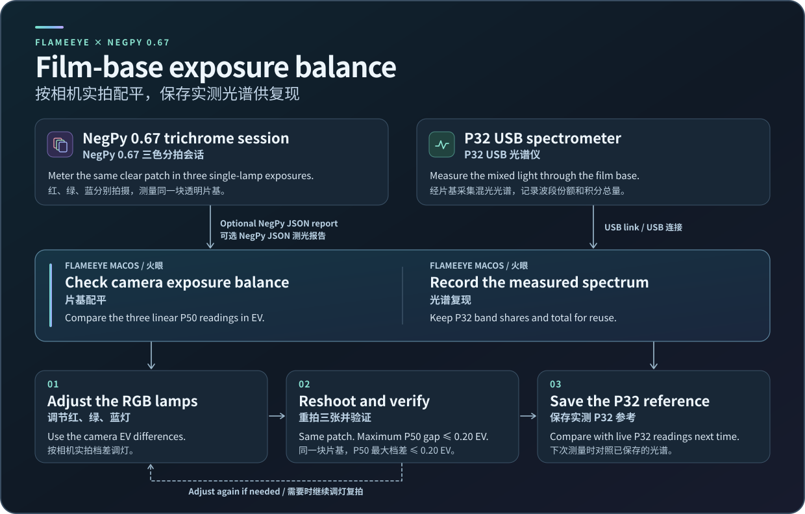
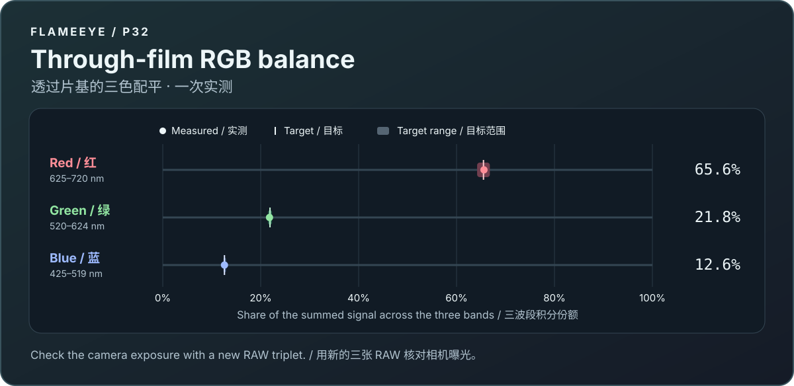

# Flameeye P32 for macOS · 火眼 P32 光谱

[中文操作说明](#中文操作说明)

Flameeye reads a P32 spectrometer over USB. Use it to measure film-base transmittance or to record the light that passes through your film base at working lamp settings.



## Build and run

Use macOS 13 or later on Apple Silicon with the Xcode command line tools. Build Flameeye from the repository root.

```sh
./research/flameeye-mac/build-app.sh
```

Open `research/flameeye-mac/dist/Flameeye Mac.app`. Connect the P32 and select it in the main window. Open **RGB 校准** for the two film-base views.

Flameeye uses LG1055 Regular and Light for Latin text and digits when these fonts are available. Otherwise, it uses the system font.

## Save the working light

1. Set the lamps to your actual working levels. Place a clear part of the film base over the full probe opening. Fix the light and probe positions, and block stray light.
2. In **片基配平**, click **开始连续测量**. Wait for stable readings, then click **保存片基光谱参考** and name the record. The record contains three P32 band shares, their integrated total, and the device and exposure details.
3. In the next session, use the same P32, film base, light mode, and placement. Select the record in **已保存参考**. Under **光谱复现**, compare the three live band shares with the saved ranges. Compare integrated totals at the same P32 exposure.

The saved shares describe the integrated signals in three wavelength ranges for your setup. Peak height and camera color are separate measurements.



## Measure transmittance separately

Open **片基透过率**. Switch the light to one RGB channel at a time. Record **无片基（首测）** with the film out. Record **有片基** with the film in, then **无片基（复测）** with the film out again. Keep the lamp on at the same level. Keep the probe in place. Flameeye uses the first P32 exposure for all three captures.

Flameeye divides the through-film band integral by the average of the two no-film integrals. Check **无片基前后变化** for changes during the measurement. Cover the full probe opening with the film for the middle capture. The transmittance measurement is separate from the saved working light.

## Check lamp output without film

For an optional lamp headroom check, remove the film and turn on one RGB channel at a time at its maximum setting. This measures each channel's available output in that setup. Capture the working light directly whenever you need a reference.

## 中文操作说明

火眼通过 USB 读取 P32，可测量片基透过率，也可保存实际工作灯档下透过片基的光谱读数。连接 P32 后，在主窗口打开「RGB 校准」。

### 保存工作灯光

1. 把灯设到实际工作档位。用透明片基完全盖住探头入光口，固定灯和探头的位置，并遮挡杂光。
2. 在「片基配平」点「开始连续测量」。等读数稳定后，点「保存片基光谱参考」并命名。记录包含三个实测波段份额、积分合计、仪器和曝光信息。
3. 下次使用同一台 P32、同一片基、灯光模式和摆位。在「已保存参考」选择记录，在「光谱复现」中对照实时份额和保存的范围。在相同 P32 曝光时间下对照积分合计。

保存的波段份额来自这套灯光的实测积分。三路峰高和相机成像颜色需要分别测量。

### 单独测量片基透过率

打开「片基透过率」。将灯分别切到红、绿、蓝单色。每色按「无片基（首测）」、「有片基」、「无片基（复测）」的顺序采集。三次都保持灯亮、灯档和摆位一致。后两次采集沿用首次的 P32 曝光。

透过率是有片基的波段积分除以前后两次无片基积分的平均值。查看「无片基前后变化」判断采集期间的变化。有片基时让片基覆盖整个探头入光口。这组透过率测量独立于保存的工作光谱参考。

### 可选的空载灯光检查

取出片基，每次只开一路灯到最大档。这样可以查看各路灯在当前摆位下的最大输出。要保存工作光谱，直接按工作灯档透过片基采集即可。

## Local wavelength correction

Put the optional device configuration in `~/Library/Application Support/Flameeye/WavelengthCorrection.json`. Supply `model`, `serial`, `firmware`, and an `anchors` array with increasing `rawNM` and `referenceNM` values. Restart Flameeye after changing the file.
